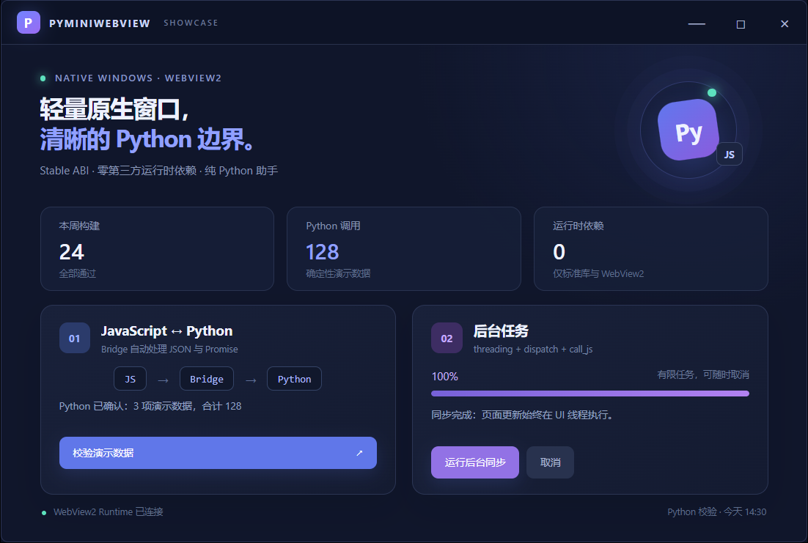
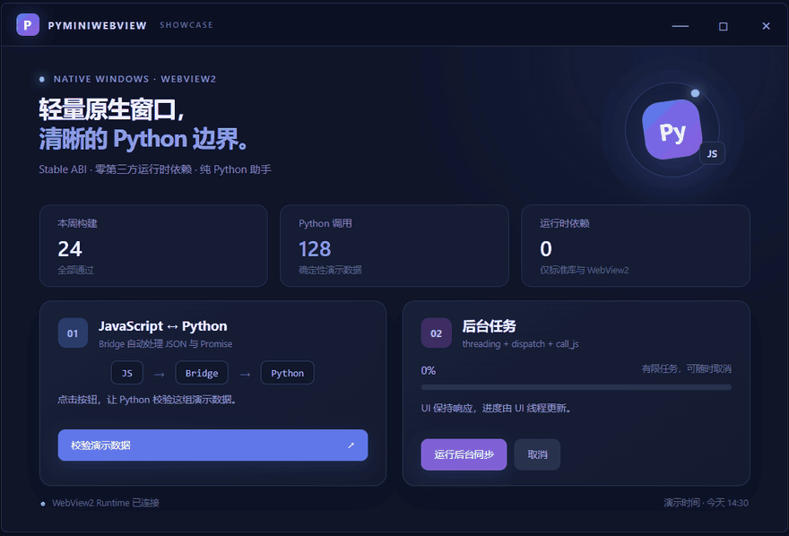

# pyminiwebview

`pyminiwebview` 是一个仅面向 Windows + Microsoft Edge WebView2 的轻量级 CPython 原生扩展。它提供窗口内 WebView2 控件、JavaScript 绑定和 UI 线程投递，不试图成为完整的桌面应用框架。

- Python 3.9+，使用 Stable ABI（`Py_LIMITED_API=0x03090000`）；wheel 标签为 `abi3`。
- 仅使用 CPython C API、Win32 和系统 WebView2 Runtime，无 Python 运行时依赖。
- 支持独立窗口和嵌入已有 `HWND` 两种模式。

## 架构与边界

分层如下：

1. `pyminiwebview.WebView`：重写的 CPython Stable ABI 绑定层，负责参数检查、GIL、Python 引用生命周期和异常转换。
2. `vendor/webview/`：vendored 的 webview C++ 引擎，负责 WebView2 COM 对象、消息窗口和事件循环；仅保留 `create_ex`、Win32 `run` 和 `dispatch` 三个 API 补丁。
3. `pyminiwebview_helpers`：纯 Python 的同步／异步 Bridge 和安全 JS 调用助手；`pyminiwebview_win32`：可选的无边框窗口、文件对话框与托盘能力。两者均无第三方运行时依赖。
4. 应用或 GUI 框架：负责业务与自定义宿主；使用 `FramelessWindow` 时，宿主窗口和完整生命周期由助手封装。

本扩展只做 WebView2 内在操作。嵌入模式下，全屏、宿主窗口标题、窗口图标、菜单、快捷键、文件对话框、托盘、注册表等均由应用处理，可使用 `ctypes` 或 `pywin32`。因此没有沿用原项目通过 `SetParent` 拆出控件的 `set_fullscreen`；嵌入模式的 `set_title` 也不会修改宿主窗口。

除 `terminate`、`js_return` 和 `dispatch` 外，其余方法应在创建实例的 UI 线程调用。`dispatch(fn)` 接受无参数 callable，在 UI 线程执行； callable 抛出的异常通过 `PyErr_PrintEx(0)` 输出，不会跨原生消息边界传播。

## 安装与运行

系统需安装 Microsoft Edge WebView2 Runtime。Windows 11 通常已预装。

**正式 PyPI 尚未发布，`python -m pip install pyminiwebview` 目前仍不可用。** 当前版本为 `0.1.6`，发布产物已在本机完成隔离安装测试；上传 TestPyPI 后，可用以下命令验证测试发布：

```bash
python -m pip install --index-url https://test.pypi.org/simple/ --no-deps pyminiwebview==0.1.6
```

TestPyPI 用于发布流程验证，不作为长期稳定分发渠道。也可以从 GitHub Actions 对应运行页面的 Artifacts 区域下载 `pyminiwebview-wheel`，解压后按下文安装 wheel；Release 发布后还可从 Releases 页面获取。未来发布到正式 PyPI 后可使用：

```bash
python -m pip install pyminiwebview
```

安装下载或本地构建的 wheel 时，在 wheel 所在目录执行（版本号以实际文件为准）：

```bash
python -m pip install pyminiwebview-0.1.6-cp39-abi3-win_amd64.whl
```

也可以直接分发 pyd：将文件命名为 `pyminiwebview.pyd`，放到应用脚本同目录或 `sys.path` 包含的其他目录，然后执行 `import pyminiwebview`。pyd 是由 Python 加载的原生扩展，不是可双击运行的程序。当前产物仅支持 64 位 Windows；abi3 wheel 可用于 64 位 CPython 3.9+，目标机器仍需安装 WebView2 Runtime。

最小示例：

```python
import pyminiwebview

with pyminiwebview.WebView(
    title="pyminiwebview",
    width=900,
    height=600,
    app_name="my-app",
    debug=True,
) as view:
    view.set_html("<h1>Hello from WebView2</h1>")
    view.run()
```

JavaScript 调用 Python：

```python
import pyminiwebview
from pyminiwebview_helpers import Bridge

with pyminiwebview.WebView(app_name="binding-demo") as view:
    bridge = Bridge(view)

    @bridge.expose
    def add(a, b):
        return a + b

    @bridge.expose("greet")
    def hello(name):
        return f"你好，{name}"

    view.set_html("<script>add(20, 22).then(console.log)</script>")
    view.run()
```

`Bridge` 只注册同步函数，自动处理位置参数 JSON 和返回值。除装饰器外，也可直接注册已有 callable：`bridge.expose(lambda: manager.open_excel(view), name="open_excel")`；`AsyncBridge` 同样支持 `bridge.expose(coroutine_function, name="load_data")`。普通 Python 异常以包含异常类型和消息的 object 拒绝 JS Promise，并在 Python 日志中记录 traceback；NaN、Infinity 和不可序列化结果会被拒绝。WebView 生命周期仍由调用者管理。

需要 `async def` 时使用独立的 `AsyncBridge`。每个实例复用一个后台 asyncio 事件循环，所有调用在该循环上并发执行，不为每次请求创建线程：

```python
import asyncio
import pyminiwebview
from pyminiwebview_helpers import AsyncBridge

with pyminiwebview.WebView(app_name="async-demo") as view:
    with AsyncBridge(view) as bridge:
        @bridge.expose
        async def load_data(value):
            await asyncio.sleep(0.1)
            return {"value": value}

        view.set_html("<script>load_data(42).then(console.log)</script>")
        view.run()
```

`AsyncBridge.close()` 必须先于 WebView `close()`，上下文管理器会按此顺序清理。关闭时停止接收新调用、取消并等待活动任务、拒绝对应 Promise，然后解绑；`cancel_all()` 可只取消当前任务而不关闭桥。取消是协作式的，协程应在清理后继续传播 `CancelledError`。协程运行在事件循环线程，UI-only WebView 方法仍需 `view.dispatch`；阻塞调用应显式移入 executor，不能指望 `async def` 自动避免阻塞。

**取消协程不等于终止 executor 中的阻塞工作。** 对 `asyncio.to_thread` 或默认 executor，`close()` 会取消协程的等待并拒绝 Promise，但不会等待、关闭默认 executor，也无法强杀已经在运行的阻塞函数。文件保存、网络等需要严格退出语义的任务，应由应用自行管理 executor 和 `threading.Event` 取消标志，让阻塞函数在合适的边界检查标志并结束；退出时的 executor `shutdown` 也由应用负责。等待不可取消的工作可能阻塞 UI，`close(timeout)` 不会替这类工作提供强制超时。

`pyminiwebview_helpers` 使用 PEP 562 惰性导出：仅导入 `Bridge` 或 `call_js` 不会加载 `async_bridge` 和 `asyncio`，首次访问 `AsyncBridge` 时才加载异步实现。未使用异步桥接的同步应用可在 Nuitka 中添加 `--nofollow-import-to=asyncio`，避免将 asyncio 打入程序；使用 `AsyncBridge` 或自行导入 asyncio 的应用不能添加该选项。

后台线程投递：

```python
import threading
from pyminiwebview_helpers import call_js

with pyminiwebview.WebView() as view:
    def update_page():
        call_js(view, "app.setStatus", "完成")

    def worker():
        view.dispatch(update_page)

    threading.Thread(target=worker).start()
    view.run()
```

`call_js(view, "setProgress", 60, "正在处理")` 使用严格 JSON 分别序列化参数，只允许标识符或 `app.setStatus` 这类点分隔路径。它是 fire-and-forget，不返回 JS 结果、不自动 dispatch；后台线程必须显式回到 UI 线程。

## Examples

[七个循序渐进的示例](https://github.com/RonTang/pyminiwebview/blob/82136feb2a09c3aa2e1ae05c50336e43a4686a59/examples/README.md)覆盖最小窗口、同步／异步 Bridge、后台任务、Win32 嵌入、无边框应用、托盘与 UTF-8 文件读写。01、02、03、05、07 提供真实启动／退出冒烟参数，其余示例给出人工验收路径。

招牌示例运行命令：`python examples/05_frameless_app/app.py`。



下面的真实窗口录屏展示最大化与还原、JS → Python → JS 调用和后台进度更新：



### 构造函数

```python
WebView(
    debug=False,
    window=0,
    autosize=False,
    width=320,
    height=240,
    url=None,
    title=None,
    icon=None,
    bgcolor=0xFFFFFF,
    user_data_folder=None,
    app_name="pyminiwebview",
    clipboard_permission="default",
)
```

- `window`：非零时嵌入该 `HWND`，否则创建独立窗口；按 64 位无符号句柄处理。
- `autosize`：仅嵌入模式，控件跟随宿主客户区尺寸。
- `title`、`icon`：仅独立窗口生效，不修改宿主窗口属性。
- `bgcolor`：Win32 `COLORREF`，字节顺序为 BGR。
- `user_data_folder`：显式指定 WebView2 用户数据目录。默认使用 `%LOCALAPPDATA%\<app_name>`，不再根据 `python.exe` 推导。
- `clipboard_permission`：`"default"`（默认，由 WebView2 询问用户）、`"allow"` 或 `"deny"`，控制剪贴板读取权限请求。

方法：`close()`、`configure_app_mode(...)`、`notify_parent_position()`、`js_bind(name, fn)`、`js_eval(js)`、`js_init(js)`、`js_return(id, status, result)`、`js_unbind(name)`、`navigate(url)`、`set_html(html)`、`set_title(title)`、`set_size(width, height, hints=0)`、`set_focus()`、`get_native_handle(kind)`、`run(hwnd=0, haccel=0)`、`terminate()`、`dispatch(fn)`。

JS 绑定回调签名为 `fn(request_id, request_json)`；第二个参数是 JSON 数组字符串，回调返回值不会被隐式发送，需显式调用 `js_return`。

独立窗口在构造期间保持隐藏，设置完请求的标题、尺寸和背景色后，等待首次 `DOMContentLoaded` 的两个动画帧再显示，避免先出现 640×480 空白窗再跳变。未加载内容时 `run()` 会直接显示；页面事件异常时有 10 秒兜底显示。该行为由项目自有绑定层实现，不修改 vendored 引擎。

### 生命周期

- `close()` 幂等，必须在创建实例的 UI 线程调用；它销毁原生资源、清除 JS 绑定，并**取消而非执行**尚未运行的 dispatch 回调。支持 `with WebView(...) as view:`，`__exit__` 会调用 `close()`。
- 类型支持 GC 遍历胶囊内的绑定 callable 和待处理 dispatch callable，因此 callback 闭包再次引用 view 时也能回收。GC 兜底与 `close()` 一样不执行排队用户代码。
- 若兜底析构发生在非 UI 线程，原生资源会投递到创建线程的消息队列销毁；需要该线程继续运行或泵送消息。显式 `close()` 仍是推荐做法。
- 嵌入宿主应在窗口显示后按需调用 `set_focus()`；构造阶段不再主动 `MoveFocus`，避免初始化时序竞态。

### 可选 Win32 助手

wheel 同时包含纯 Python、零第三方依赖的 `pyminiwebview_win32` 助手包，不扩大原生 WebView2 核心。

`FramelessWindow` 封装无边框宿主、内嵌 WebView、同步 Bridge、首帧显示和资源清理，应用无需编写 `ctypes`：

```python
from pyminiwebview_win32 import FramelessWindow

with FramelessWindow(
    title="My App",
    width=1100,
    height=740,
    min_width=720,
    min_height=520,
    resizable=True,
    app_name="my-app",
    bgcolor=0x0026120D,
    shadow=True,
    dark_mode=True,
    dwm_border=True,
    dwm_border_color=None,
    inner_border_width=1,
    inner_border_color=0x0026120D,
) as window:
    window.bridge.expose(lambda: "ready", name="get_status")
    window.view.set_html("""
      <button onclick="__window_minimize()">最小化</button>
      <button onclick="__window_toggle_maximize()">最大化/还原</button>
      <button onclick="__window_close()">关闭</button>
    """)
    window.run()
```

内置 JS 函数为 `__window_minimize()`、`__window_toggle_maximize()`、`__window_close()`、`__window_start_move()`、`__window_start_resize(direction)` 和自动首帧回调 `__window_ready()`。左右和底边保留原生 Win32 非客户区缩边，顶部使用不占布局的不可见原生命中区，支持八方向拖动；命中区域宽度由系统和 DPI 决定，无需页面添加手柄；自定义手柄仍可调用 `__window_start_resize(direction)`，方向为 `l`、`r`、`t`、`b`、`tl`、`tr`、`bl`、`br`。页面无需调用 ready，库会在 DOM 就绪后的两个动画帧自动显示窗口。可选 `on_maximize_change` 回调用于更新自定义标题栏图标。

`resizable=True` 默认允许边缘拖动缩放和最大化。固定大小窗口显式传入 `resizable=False`：

```python
with FramelessWindow(width=800, height=600, resizable=False) as window:
    window.view.set_html("<h1>Fixed size</h1>")
    window.run()
```

固定模式会禁用八方向缩放、`__window_start_resize()`、最大化按钮对应的 `__window_toggle_maximize()` 以及标题栏双击最大化，同时保留标题栏拖动和最小化。自定义标题栏应在此模式下隐藏或禁用最大化按钮。

阴影、深色模式、DWM 外框和宿主内边框相互独立：

- `shadow=True`：启用系统 DWM 阴影；`False` 会禁用非客户区渲染并清除框架扩展。最大化时清除框架，还原时按此参数恢复。
- `dark_mode=False`：是否设置 `DWMWA_USE_IMMERSIVE_DARK_MODE`。深色模式下 Windows 会使用更大、更深的系统阴影，需同时保持 `shadow=True`；此参数不会修改 HTML 配色，也不会改变其他边框参数。
- `dwm_border=True`：显示 Windows 绘制的窗口外框；`False` 使用 `DWMWA_COLOR_NONE` 隐藏外框，但不改变阴影设置。
- `dwm_border_color=None`：DWM 外框使用系统默认颜色；也可传入 32 位 Win32 `COLORREF`（与 `bgcolor` 一样为 BGR 字节顺序）。仅在 `dwm_border=True` 时生效。
- `inner_border_width=1`：宿主内边框的像素宽度，必须是非负整数。WebView 内容按该宽度向四周内缩，0 表示没有内边框，最大化时自动取消内缩。
- `inner_border_color=None`：宿主内边框使用 `bgcolor`；也可传入独立的 `COLORREF`。它不会影响 DWM 外框。

DWM 外框没有公开的宽度设置接口，粗细由 Windows 和 DPI 决定；`DWMWA_VISIBLE_FRAME_BORDER_THICKNESS` 只能读取系统宽度，`DwmExtendFrameIntoClientArea` 的边距用于框架延伸和阴影，并不是外框线宽。需要任意像素宽度时使用 `inner_border_width`。

`window.view` 提供完整嵌入式 `WebView`，`window.bridge` 用于注册业务函数；`FramelessWindow.close()` 幂等，并销毁宿主、关闭 WebView、注销窗口类和释放画刷。创建、运行和关闭都应在同一 UI 线程执行。完整的拖动、边缘缩放、后台任务示例见 `examples/05_frameless_app/app.py`。

文件对话框在 UI 线程调用；取消返回 `None`，`CommDlgExtendedError` 非零时抛出 `OSError`。保存对话框允许新文件，并提示覆盖已有文件。

```python
from pyminiwebview_win32 import open_file_dialog, save_file_dialog

source = open_file_dialog(
    hwnd_owner=view.get_native_handle(pyminiwebview.NATIVE_HANDLE_KIND_UI_WINDOW),
    filters=[("Text Files", "*.txt"), ("All Files", "*.*")],
)
target = save_file_dialog(initial_file="new.txt")
```

托盘图标使用完整 64 位 Win32 结构体和 `HWND_MESSAGE` 隐藏窗口。必须在 `run()` 所在线程创建和移除，退出时调用幂等的 `remove()`：

```python
from pyminiwebview_win32 import TrayIcon

tray = TrayIcon(tooltip="My App", on_click=lambda: view.set_focus())
with pyminiwebview.WebView() as view:
    try:
        view.run()
    finally:
        tray.remove()
```

需要区分左右键时使用 `on_left_click` 和 `on_right_click`；通用 `on_click` 仍兼容两种点击。运行 `python manual_tests/test_tray.py` 可验证完整托盘应用行为：关闭按钮只隐藏窗口，左键显示/隐藏，右键菜单提供“Show / Hide”和“Exit”，只有退出菜单结束程序。

全屏、宿主标题、菜单、快捷键和其他 Shell 高级集成仍由应用通过 `ctypes` 等自行处理，不引入 `pywin32` 依赖。

### 多窗口与宿主

嵌入已有窗口使用 `WebView(window=host_hwnd, autosize=True)`；`get_native_handle()` 已提供顶层窗口、WebView 控件和浏览器控制器句柄，无需重复的 `parent_hwnd` API。多个 WebView 的窗口关系、焦点和生命周期由应用管理；同一 UI 线程只运行一个共享消息循环，不为每个窗口分别启动消息泵。

### 桌面应用模式

```python
view.configure_app_mode(
    disable_browser_accelerators=True,
    disable_nc_region_support=True,
    redirect_new_window_to_system_browser=True,
)
```

三个参数默认均为 `True`：

- `disable_browser_accelerators`：通过 `ICoreWebView2Settings3` 禁用浏览器加速键，防止 F5/Ctrl+R 刷新应用界面和 Ctrl+F 打开查找栏；应用自己的加速键通过 `run(hwnd, haccel)` 的 `HACCEL` 处理。接口查询或设置失败会抛出带 HRESULT 的 `RuntimeError`。
- `disable_nc_region_support`：通过 `ICoreWebView2Settings9` 显式关闭非客户区支持，避免 CSS `app-region` 生成的进程内子窗吞掉宿主 `WM_NCHITTEST` 边缘命中。运行时过旧而返回 `E_NOINTERFACE` 时表示该功能本来就不存在，会安全跳过；其他失败抛出 `RuntimeError`。
- `redirect_new_window_to_system_browser`：用 `NewWindowRequested` 将 `window.open` 等请求转到系统默认浏览器，并标记请求已处理；仅允许 `http`/`https`，其他协议直接拦截，`ShellExecuteW` 失败会由 COM 回调返回错误；重复配置不会重复注册事件。

上述桌面应用策略参考 [Wails](https://github.com/wailsapp/wails) 实践，仅使用 WebView2 公共 API。宿主窗口收到 `WM_MOVE` 时调用 `view.notify_parent_position()`，通过 `NotifyParentWindowPositionChanged` 防止 `select` 下拉、日期选择器等页面原生弹层按旧坐标漂移。

## 构建

需要 MSVC（Visual Studio 2022 的“使用 C++ 的桌面开发”组件）和 Python 3.9+。在 **x64 Native Tools Command Prompt** 或已初始化 MSVC 环境的终端执行：

```bash
python -m pip install setuptools wheel pytest
python setup.py build_ext --inplace
python -m pytest
```

构建 PEP 517 wheel：

```bash
python -m pip install build
python -m build --wheel
```

`build_ext --inplace` 生成可直接导入的 `pyminiwebview.pyd`；`python -m build --wheel` 在 `dist/` 生成可分发的 abi3 wheel。wheel 包含 pyd、`pyminiwebview_win32` 和 `pyminiwebview_helpers`，无需另外复制 `vendor/` 头文件或 WebView2 SDK；examples、测试和演示素材不会打入 wheel。

`setup.py` 同时设置 `py_limited_api=True`，`setup.cfg` 指定 `cp39` ABI 基线。GitHub Actions 使用 cibuildwheel 构建并测试 `win_amd64` 的 abi3 wheel；发布 GitHub Release 时通过 PyPI Trusted Publishing 发布。PyPI 项目需先配置对应仓库和工作流的 trusted publisher。

## vendored 代码与补丁管理

当前基线为 webview/webview **tag `0.12.0`**，完整 commit **`3ab4b5d722438fc8a13e6ca830c5e2372d19a01d`**，同步日期 **2026-11-12**。上游 `core/include/webview*` 映射到本仓库 `vendor/`；WebView2 SDK 使用官方 `1.0.2420.47` 头文件，以支持 `ICoreWebView2Settings9` 的非客户区设置。

本地仅保留三个引擎 API 补丁：

1. `webview_create_ex`：用户目录、应用名、剪贴板策略及嵌入 COM 初始化。
2. `webview_run_with_accelerators(hwnd, haccel)`：Win32 加速键和消息循环错误检查；`webview_run(w)` 保持上游签名。
3. `webview_dispatch`：投递错误、析构清理、异常边界及后台终止。

上游 0.12.0 已公开 `webview_dispatch`；本项目补丁是上述行为的加固，不是新增 API。

**补丁封顶原则：新需求只能放入 Python 层或项目自有源码，不再增加 vendor 补丁 API。** 背景色等 WebView2 操作已经直接在 `_module.cpp` 实现。

所有补丁点均以 `pyminiwebview patch begin/end` 成对标记；完整补丁为 `patches/0001-pyminiwebview-engine-extensions.patch`，详细元数据见 `vendor/README.md`。

同步上游的 runbook：

1. 用 `git ls-remote --tags` 选择最新 release tag，并将 annotated tag 解引用为完整 commit。
2. 在临时目录检出该 tag，确认文件布局和 WebView2 SDK 版本。
3. 用上游 `core/include/webview*` 替换 `vendor/` 对应文件，再执行 `git apply --check` 并应用现有 patch。
4. 若补丁冲突，只手工移植上述三个 API；检查所有改动均有成对标记。
5. 运行 `build_ext --inplace`、完整 pytest 和真实 `manual_tests/test_frameless.py` 窗口测试。
6. 从干净上游基线重新生成 patch，验证应用后文件一致，再更新 tag、commit 和同步日期。

上游已实现同名功能时不能直接退役补丁。只有其公开 API 覆盖完整语义、`_module.cpp` 可完全移除本地扩展调用，且目录/权限/线程/析构行为与全部测试均无回归时才退役；删除对应补丁后重新生成 patch。

## 测试范围

pytest 在真实 WebView2 Runtime 中覆盖：

- 1000 次绑定/解绑的回调引用计数稳定，以及导航、HTML 加载和销毁。
- 独立窗口构造期隐藏、首帧显示和请求尺寸稳定；无边框助手的真实宿主、内置桥接、首帧和清理。
- 实际 JS→Python 回调与 `js_return`。
- `run()` 期间 `threading.Timer` 能执行，且 `dispatch` 在 UI 线程运行。
- 通过 `CreateWindowExW` 创建宿主窗口并验证 autosize。
- `configure_app_mode()` 的默认配置与重复调用，以及 `notify_parent_position()`。
- 幂等 `close()`、上下文管理器、绑定引用环回收、非 UI 线程 GC 后的 UI 原生收尾。
- 排队 dispatch 在 close/析构时取消且释放引用，反复创建销毁和 dispatch/terminate/close 并发压力。
- 非法参数抛出 Python 异常，64 位 `HWND` 参数解析。
- 文件对话框 flags、路径缓冲区、取消/错误语义，以及真实托盘创建、消息回调和清理。
- Bridge 的 JSON 成功／错误路径、call_js 参数与函数名校验，以及真实 WebView2 双向调用和引用回收。
- AsyncBridge 的并发、异常、取消、关闭超时、启动失败回收、executor 关闭边界和引用回收；1000 次并发调用、反复创建销毁，以及真实 WebView2 的 300 次混合结果压力测试。
- 01、02、03、05、07 通过子进程真实启动、执行页面交互并正常清理退出。

无边框示例的 PNG/GIF 来自真实应用窗口。需要重录时先原地构建扩展，再运行 `python tools/record_frameless_demo.py`；该开发脚本使用 Pillow、PyAutoGUI 和 pywin32，它们不是库的运行时依赖。

GitHub Actions 还将同一个 cp39 abi3 wheel 安装到 CPython 3.9、3.10、3.11、3.12、3.13 和 3.14，逐版本从仓库外导入纯 Python 助手，并执行真实 WebView2 创建、配置、位置通知和关闭。build-wheel 阶段通过 `tools/test_installed_wheel.py` 将测试和示例复制到临时目录、清除 `PYTHONPATH` 后运行完整测试，避免源码树遮蔽 wheel 中缺失或错误的纯 Python 文件。

## 验证

运行 `python manual_tests/test_frameless.py` 打开自包含的无边框宿主示例，手动确认：

- F5/Ctrl+R 不再刷新应用界面。
- 点击“系统浏览器验证”链接后，页面新窗口请求转到系统浏览器。
- 无边框窗最大化不遮挡任务栏，还原后位置正确，且无法缩小到 640×480 以下。
- 打开 `select` 弹层并拖动窗口若干次，再次打开时弹层跟随宿主位置，不发生坐标漂移。

Win32 助手另需人工确认：打开对话框能选择已有文件、取消返回 `None`；保存对话框允许新文件并提示覆盖；托盘左右键触发回调，`remove()` 后无图标残留。

## CHANGELOG

### 0.1.6

- 独立窗口与 `FramelessWindow` 的首帧等待恢复为两个 `requestAnimationFrame`，减少额外一帧的启动延迟。
- `FramelessWindow` 改为在窗口隐藏时配置 DWM 框架，显示窗口时不再重复扩展框架，降低启动闪白风险。
- 缓存 DWM 框架宽度与边框颜色，删除激活时的重复设置；尺寸变化仅在状态实际改变时调用相应 Win32 API，保留宿主内边框行为。
- `pyminiwebview_helpers` 改为 PEP 562 惰性导出，仅使用 `Bridge` / `call_js` 时不再导入 `asyncio`，同步应用可通过 Nuitka `--nofollow-import-to=asyncio` 减少打包体积。
- `FramelessWindow` 使用原生 Win32 非客户区和顶部不可见命中区支持八方向缩放，无需页面手柄；移除原生标题栏按钮并保留任务栏最小化／还原切换，05 示例删除重复缩放代码。
- 修复最大化时顶部命中层隐藏路径的未定义名称，以及托盘窗口创建失败时的窗口类泄漏；真实测试覆盖最大化／还原，CI 增加 Ruff `F821` 检查。
- wheel 携带项目许可证、第三方声明以及 webview 和 WebView2 许可证。

### 0.1.5

- `FramelessWindow` 新增独立的 `shadow`、`dark_mode`、`dwm_border` / `dwm_border_color`、`inner_border_width` / `inner_border_color` 参数；系统阴影、深色模式、DWM 外框与宿主内边框不再耦合。
- 使用 `WS_OVERLAPPEDWINDOW` 和四边 1px DWM 框架扩展实现系统阴影；深色模式支持更大、更深的 DWM 阴影。文档明确 DWM 外框宽度只能由系统控制，任意像素宽度由宿主内边框实现。
- 修复八方向斜向缩放、圆角窗口关闭按钮右上角填充、最小化还原后的按钮残留高亮，以及最小化动画期间 WebView 重排导致宿主背景整窗闪现的问题。
- 窗口还原和激活时重新应用 DWM 外框配置，避免系统默认外框短暂覆盖自定义内边框；新增最小尺寸、DWM 状态、边框参数组合和窗口消息回归测试。

### 0.1.4

- `Bridge` / `AsyncBridge` 支持 `expose(callable, name="javascriptName")` 直接注册已有函数和 lambda。
- 独立原生窗口改为请求尺寸与首帧内容就绪后显示，消除构造期 640×480 空白窗跳变；仅修改项目自有绑定层。
- 新增 `pyminiwebview_win32.FramelessWindow`，封装无边框宿主、窗口控制桥接、首帧显示和资源清理；05 示例不再包含 `ctypes` 样板，并加入真实冒烟测试。

### 0.1.3

- 新增六个循序渐进的 examples，覆盖最小窗口、Bridge、后台任务、Win32 嵌入、无边框应用、托盘与 UTF-8 文件读写，并附学习索引和冒烟验证。
- 新增纯 Python、零第三方运行时依赖的 `pyminiwebview_helpers`，提供同步函数 `Bridge` 和严格 JSON 的 fire-and-forget `call_js`。
- 新增 `AsyncBridge` 和 07 异步示例：单个可复用 asyncio 事件循环、并发任务、协作式取消、有界关闭和完整生命周期管理；修复事件循环启动失败后的线程清理，并明确 executor 阻塞工作的关闭契约。
- 增加 Bridge/call_js 的真实 WebView2 与参数边界测试、示例启动／交互／退出测试，保持关闭和 GC 引用回收保证；新增异步并发与压力测试，并在仓库外隔离验证 wheel 中的纯 Python 包。
- 修复托盘显示窗口时前台激活被拒绝仍调用 `set_focus()` 的异常路径；06 示例和手动托盘测试仅在激活成功后移动焦点。
- 新增基于真实无边框示例录制的 PNG、GIF 和开发用录制脚本，并接入 README；演示素材不进入 wheel。

### 0.1.2

- 新增幂等 `close()` 和上下文管理器；close 与兜底析构均取消排队用户回调。
- 支持绑定/排队 callable 的 GC 遍历，修复 callback 与 WebView 的引用环泄漏；非 UI 析构延迟原生销毁到 UI 线程。
- 增加生命周期压力测试、宿主先销毁覆盖和 CPython 3.9–3.14 abi3 真实创建矩阵。
- 外部新窗口仅允许 `http`/`https`，并检查 `ShellExecuteW` 返回值。
- 移除构造阶段的主动 `MoveFocus`，由宿主显示后调用 `set_focus()`，避免初始化焦点竞态。
- 新增纯 Python `pyminiwebview_win32` 助手包，提供文件对话框和完整 64 位托盘实现。

### 0.1.1

- 新增 `configure_app_mode()`：禁用浏览器加速键和非客户区子窗，并将新窗口请求转到系统浏览器。
- 新增 `notify_parent_position()`，供宿主 `WM_MOVE` 同步页面原生弹层坐标。
- WebView2 SDK 头文件升级到官方 `1.0.2420.47`。
- 恢复上游 `webview_run(w)` 签名，加速键入口独立为 `webview_run_with_accelerators()`。

### 0.1.0

- 首个 Stable ABI 基线：独立/嵌入窗口、JavaScript 绑定、UI 线程投递和真实 WebView2 测试。

## 致谢与许可

- [webview/webview](https://github.com/webview/webview)：MIT，版权 Serge Zaitsev / Steffen André Langnes。
- Microsoft WebView2 SDK 官方头文件保留原始版权声明，BSD 3-Clause 许可证见 `licenses/Microsoft-WebView2-LICENSE.txt`。

本项目采用根目录的 MIT License，Copyright (c) 2026 Ron Tang。第三方来源及改动说明见 `THIRD_PARTY_NOTICES.md`。
